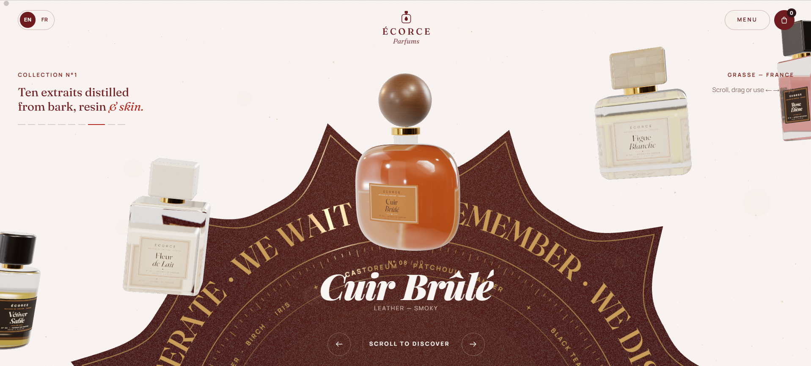
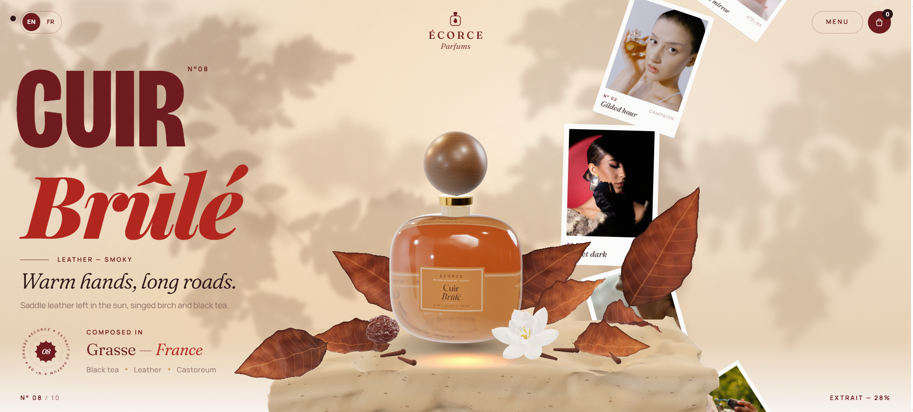
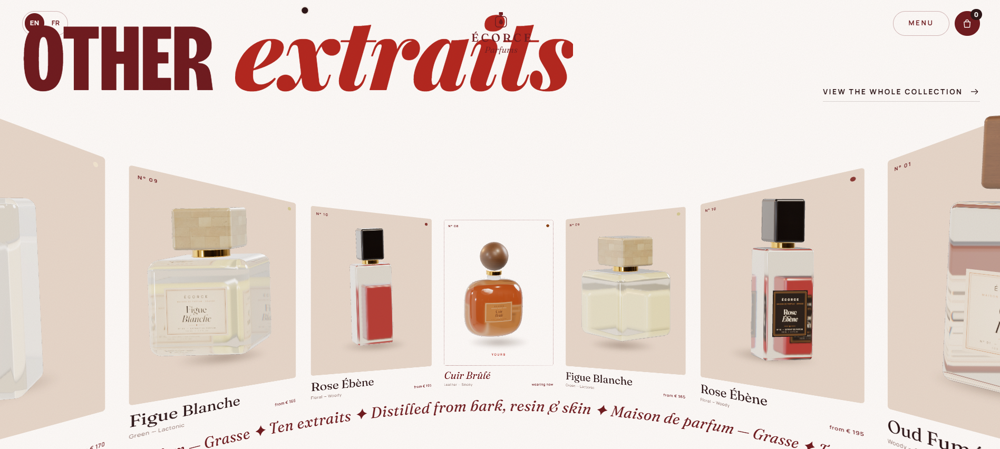
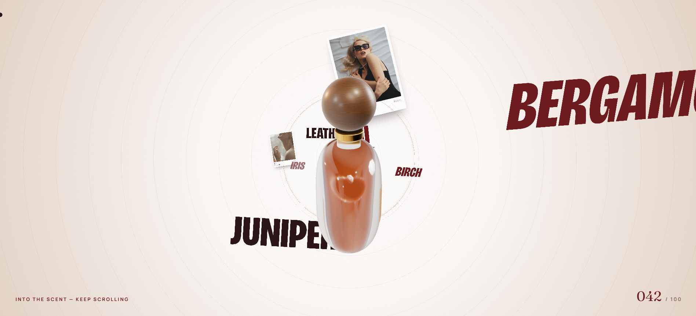
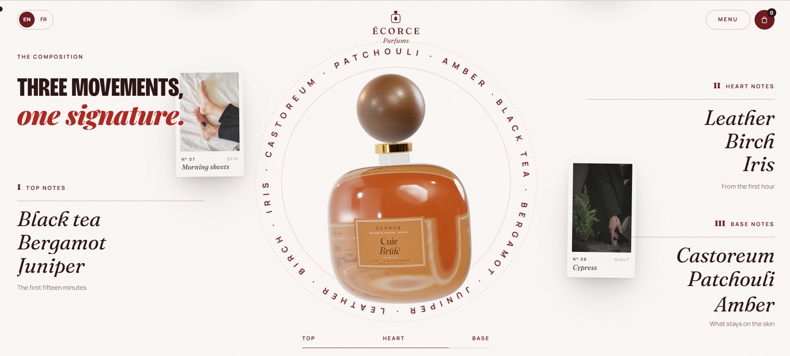

# ÉCORCE — Maison de Parfum · showcase

A responsive, scroll-led perfume house website inspired by the design studies and screenshots in this repository. It includes a custom-drawn bottle, a simulated 3D fragrance-notes canvas with interactive orbit, spiral and bloom formations, and a collection of editorial product sections. Commerce is illustrative only.

The site is a small, dependency-free Node.js project.

## Run locally

1. Install [Node.js](https://nodejs.org/) if it is not already installed.
2. From this folder, run `npm run dev`.
3. Open [http://localhost:3000](http://localhost:3000).

Set the `PORT` environment variable to use a different port.

## Screenshots

**Home — bottle carousel over the star seal**

**Product page — still life hero**

**Other extraits — full-width draggable arc**

**Into the scent — 3D word tunnel**

**The composition — notes orbiting the bottle**

**Worn & wanted — campaign photo arc**

## Design references

- [DESIGN.md](DESIGN.md) — palette, type, layout, motion language, how the pieces fit
- [PROMPTS.md](PROMPTS.md) — how to prompt an AI assistant to build a site like this, step by step
- [PSEUDOCODE.md](PSEUDOCODE.md) — the key mechanisms in plain-language pseudocode

## Credits

Fonts: DM Serif Display, DM Sans and Manrope, served by Google Fonts. This is an unaffiliated concept; the page flow was inspired by the design references included in this repository.
